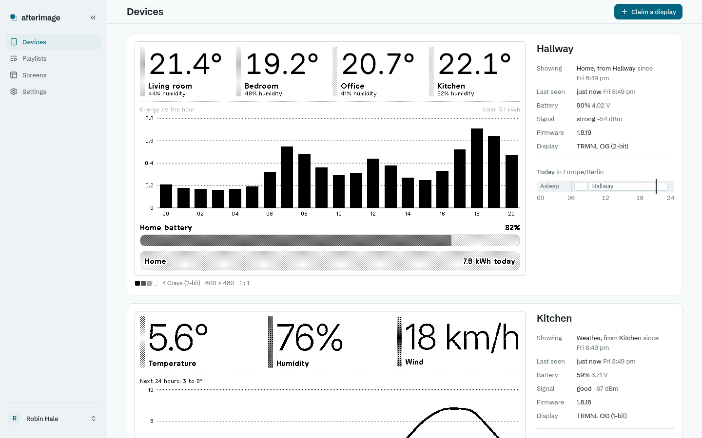
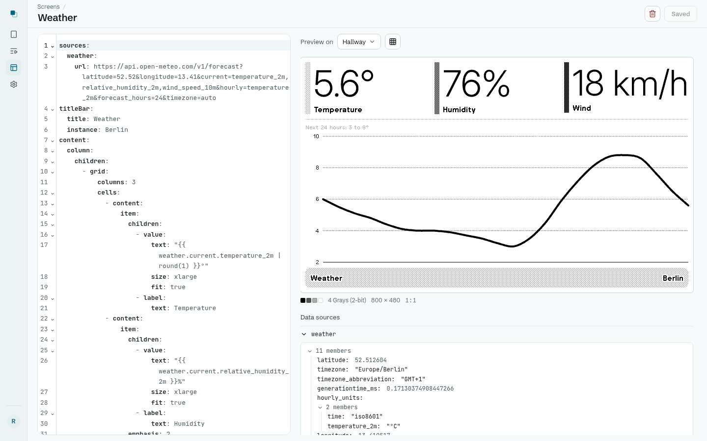
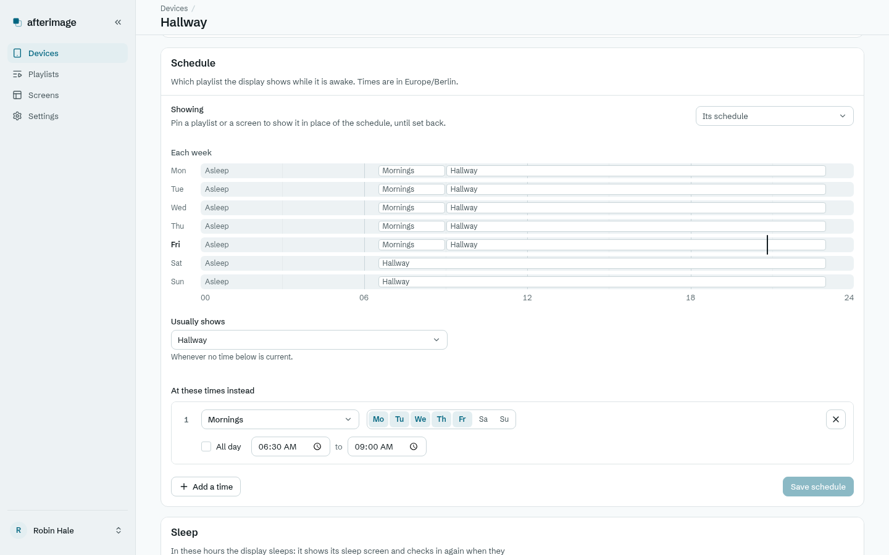
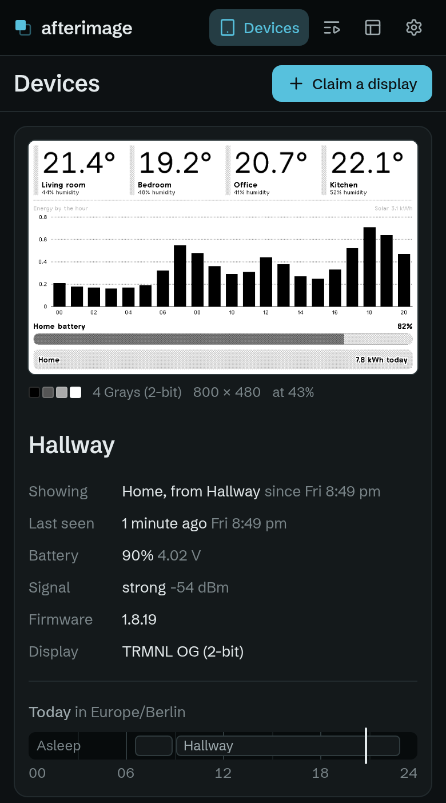

# Afterimage

A self-hosted server for [TRMNL](https://trmnl.com) e-paper displays. Displays keep their stock firmware; Afterimage draws their screens from your data.

- Screens as YAML documents of TRMNL's components, rendered in TRMNL's design
- Playlists, weekly schedules and sleep windows
- Firmware updates for every TRMNL board
- Home Assistant over MQTT
- A management API and an MCP endpoint for scripts and agents
- Password or OIDC sign-in

[docs/design.md](docs/design.md) explains how it works.

## Screenshots









## Installation

### Docker

```sh
docker run -d -p 8080:8080 -v afterimage:/data -e TZ=Europe/Berlin ghcr.io/lutyjj/afterimage
```

### NixOS

```nix
imports = [ inputs.afterimage.nixosModules.default ];
services.afterimage = {
  enable = true;
  openFirewall = true;
};
```

| Option | Default |
|---|---|
| `listenAddress`, `port` | `0.0.0.0`, `8080` |
| `openFirewall` | `false` |
| `settings` | `{ }`, the variables below |
| `environmentFile` | A file of secret variables |

### First display

1. Open `http://<host>:8080` and create the first account.
2. In the display's Wi-Fi portal, set the server URL to `http://<host>:8080`.
3. Enter the code the display shows under **Claim a display**.

## Configuration

Environment variables; `afterimage --help` lists the matching flags.

| Variable | Default | Sets |
|---|---|---|
| `AFTERIMAGE_BIND` | `0.0.0.0:8080` | Listen address |
| `AFTERIMAGE_DATA_DIR` | `data` | Database and images |
| `AFTERIMAGE_CACHE_DIR` | `<data>/cache` | Firmware images |
| `AFTERIMAGE_URL` | | Public URL, such as `https://afterimage.example`; needed for OIDC |
| `AFTERIMAGE_TIME_ZONE` | `TZ`, else the host's | Time zone of schedules and screens |
| `AFTERIMAGE_WEB_DIR` | The packaged web UI | Built web UI |
| `AFTERIMAGE_TRMNL_URL` | `https://trmnl.com` | Source of firmware |
| `AFTERIMAGE_PASSWORD_SIGN_IN` | `true` | Password sign-in; `false` needs OIDC |
| `AFTERIMAGE_OIDC_ISSUER` | | OIDC provider; redirect URL `<AFTERIMAGE_URL>/manage/auth/oidc/callback` |
| `AFTERIMAGE_OIDC_CLIENT_ID`, `_CLIENT_SECRET` | | OIDC client |
| `AFTERIMAGE_OIDC_NAME` | `Single sign-on` | Sign-in button label |
| `AFTERIMAGE_MQTT_URL` | | `mqtt://` or `mqtts://` broker; unset, set it in the web UI |
| `AFTERIMAGE_MQTT_USERNAME`, `_PASSWORD` | | Broker credentials |
| `AFTERIMAGE_MQTT_TOPIC` | `afterimage` | Base topic |
| `AFTERIMAGE_MQTT_DISCOVERY_PREFIX` | `homeassistant` | Home Assistant discovery prefix |
| `AFTERIMAGE_SECRET_<NAME>` | | Secret that data sources read as `{{ secrets.<NAME> }}` |

Scripts and agents authenticate with a token from **Settings → Tokens and MCP** (`Authorization: Bearer <token>`). The management API is at `/manage/`, with its OpenAPI document in each [release](https://github.com/lutyjj/afterimage/releases); MCP is at `/mcp`.

## License

[MIT](LICENSE)
